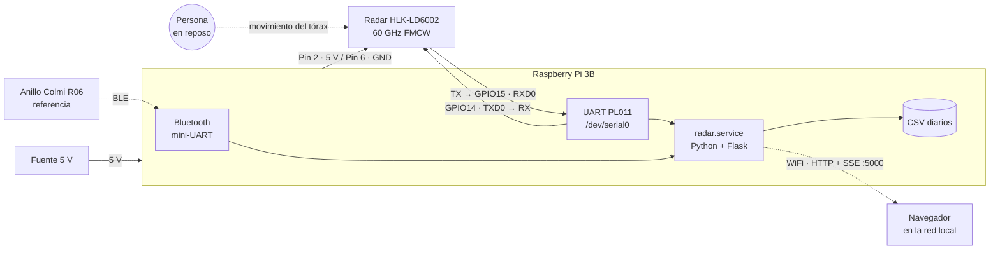
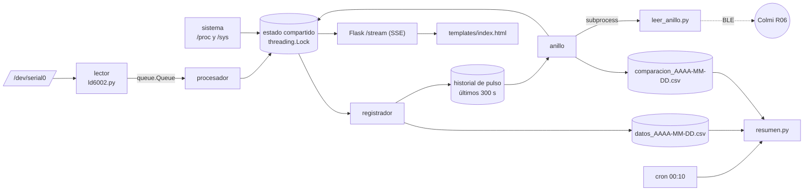
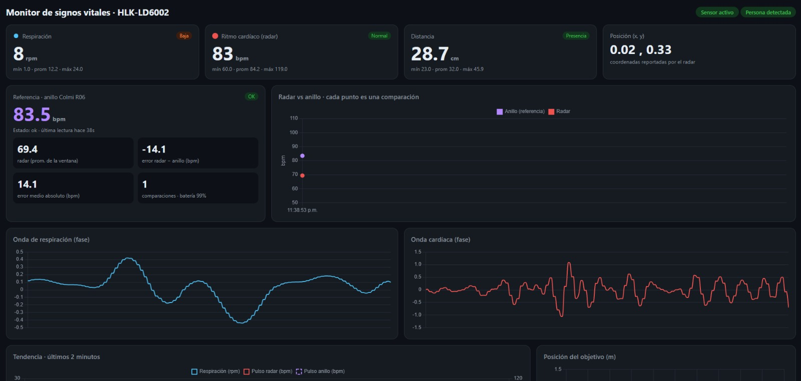
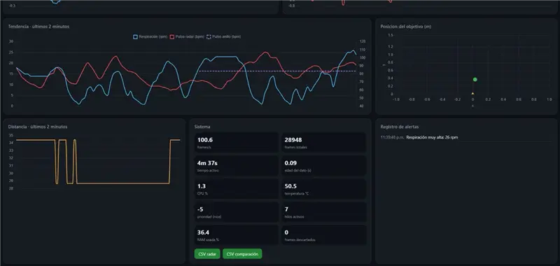

# mmVital · Monitor de signos vitales con radar mmWave

Sistema embebido sobre **Raspberry Pi 3B** que lee un radar de 60 GHz **HLK-LD6002** por UART, extrae frecuencia respiratoria, ritmo cardíaco, distancia y posición de una persona sin contacto, y los muestra en una **aplicación web en tiempo real**. Incluye registro automático en CSV y una comparación del pulso contra un dispositivo de referencia (anillo **Colmi R06**).

Proyecto de la asignatura **[Sistemas Embebidos]** · **Lina Maria Ramirez y Valentina Rozo** · **Universidad Javeriana / 2026**

> **Aviso:** es un proyecto académico. Ni el radar ni el anillo son instrumentos médicos, y las mediciones no sirven para diagnóstico.

## Contexto y objetivo

La frecuencia cardíaca y la respiratoria se miden normalmente con sensores de contacto (ECG, PPG, bandas torácicas), que exigen buena colocación, son incómodos en monitoreo prolongado y pueden irritar la piel. Un radar FMCW de ondas milimétricas detecta los micromovimientos del tórax sin contacto.

**Objetivo:** implementar un sistema embebido de bajo costo que controle el radar HLK-LD6002 desde una Raspberry Pi, adquiera, interprete, registre y visualice la respiración y el pulso, y compararlo en pruebas básicas contra un dispositivo de referencia comercial.

**Fuera de alcance:** validación clínica, estudios con muchos participantes, modelos de IA y procesamiento propio de la señal cruda del radar (el sensor entrega HR y RR ya calculados).

## Contenido

- [Contexto y objetivo](#contexto-y-objetivo)
- [Qué hace](#qué-hace)
- [Hardware](#hardware)
- [Conexiones](#conexiones)
- [Configuración de la Raspberry Pi](#configuración-de-la-raspberry-pi)
- [Arquitectura de software](#arquitectura-de-software)
- [Protocolo del radar](#protocolo-del-radar)
- [Aplicación web](#aplicación-web)
- [Instalación como servicio](#instalación-como-servicio)
- [Relación con los talleres de la clase](#relación-con-los-talleres-de-la-clase)
- [Datos generados](#datos-generados)
- [Comparación con el anillo Colmi R06](#comparación-con-el-anillo-colmi-r06)
- [Resultados](#resultados)
- [Limitaciones conocidas](#limitaciones-conocidas)
- [Estructura del repositorio](#estructura-del-repositorio)

## Qué hace

- Lee el radar por UART y decodifica sus tramas binarias verificando los checksums.
- Calcula y muestra respiración (rpm), pulso (bpm), distancia, presencia y posición.
- Dibuja las ondas de fase de respiración y de corazón, tendencias de 2 minutos y un mapa de posición.
- Genera alertas por valores fuera de rango o pérdida de presencia.
- Guarda un CSV por día con los datos del radar, y otro con las comparaciones contra el anillo.
- Muestra el estado de la propia Raspberry Pi: CPU, temperatura, memoria, prioridad e hilos.
- Corre como **servicio de Linux** que arranca solo, con un resumen diario programado.

## Hardware

| Componente | Detalle |
|---|---|
| Computador | Raspberry Pi 3B, Raspberry Pi OS de 64 bits |
| Sensor | HLK-LD6002 (radar mmWave de 60 GHz) |
| Referencia | Anillo inteligente Colmi R06 (Bluetooth LE) |
| Cableado | 4 cables dupont hembra-hembra |
| Alimentación | Fuente de 5 V estable para la Pi |

### Diagrama de bloques



El radar procesa la señal internamente y entrega por UART fases, frecuencia respiratoria, pulso, distancia y posición ya calculados. La Pi solo recibe, decodifica, registra, compara y publica.

## Conexiones

El radar se alimenta con 5 V y su UART trabaja a 3,3 V, compatible con los GPIO de la Pi. **TX y RX van cruzados.**

| Sensor LD6002 | Raspberry Pi 3B |
|---|---|
| 5V | Pin 2 (5V) |
| GND | Pin 6 (GND) |
| TX | Pin 10 (GPIO15 · RXD0) |
| RX | Pin 8 (GPIO14 · TXD0) |
| P19 | sin conectar |

> El orden de pines puede variar según la versión del módulo. Revisa la serigrafía.

## Configuración de la Raspberry Pi

### 1. UART para el radar

En la Pi 3B, el UART principal (PL011, `ttyAMA0`) lo ocupa el Bluetooth por defecto y `serial0` apunta al mini-UART (`ttyS0`), que es poco fiable. Se mueve el Bluetooth al mini-UART para liberar el UART bueno.

En `/boot/firmware/config.txt`:

```
enable_uart=1
dtoverlay=miniuart-bt
core_freq=250
```

En `/boot/firmware/cmdline.txt`, borrar `console=serial0,115200` (el archivo debe seguir siendo **una sola línea**), y desactivar la consola serie:

```bash
sudo systemctl disable --now serial-getty@ttyAMA0.service
sudo reboot
```

Verificar que `/dev/serial0` apunte a `ttyAMA0`:

```bash
ls -l /dev/serial0
```

### 2. Permisos del puerto serie

```bash
sudo usermod -aG dialout $USER
```

(Cerrar sesión y volver a entrar.) Sin esto aparece `Permission denied` en `/dev/serial0`.

### 3. Baudrate

El radar transmite a **115200 baudios**. El valor se determinó con `diagnostico/scan_baud.py`, que prueba varias velocidades y cuenta tramas con checksum válido: solo 115200 produjo tramas válidas.

## Arquitectura de software



| Hilo | Función |
|---|---|
| `lector` | Lee el UART y encola cada trama. Solo lee, no interpreta. |
| `procesador` | Saca tramas de la cola, las decodifica y actualiza el estado. |
| `registrador` | Escribe una fila por segundo en el CSV del día. |
| `sistema` | Mide CPU, temperatura y memoria leyendo `/proc` y `/sys`. |
| `anillo` | Lanza la lectura del anillo como proceso aparte y calcula el error. |

Los hilos se comunican con una `queue.Queue` y el estado compartido se protege con un `threading.Lock`. La lectura del anillo corre en un **proceso separado** para que cualquier bloqueo del Bluetooth no afecte al radar.

### Correspondencia con los módulos de la propuesta

La propuesta planteaba un módulo por responsabilidad. En la implementación se agruparon en menos archivos, y cada responsabilidad quedó en un hilo:

| Módulo propuesto | Implementación |
|---|---|
| `main.py` | `app.py`: arranca los hilos y el servidor Flask |
| `config.py` | Constantes al inicio de `app.py` (`RING_ADDR`, `VENTANA_RADAR`…) y de `ld6002.py` (puerto, baudrate) |
| `sensor_reader.py` | `ld6002.py` (`LD6002`) + hilo `lector` |
| `data_parser.py` | `ld6002.py` (checksums y separación de tramas) + hilo `procesador` (decodifica cada tipo) |
| `monitor.py` | Hilo `registrador` (CSV) y alertas de rango en la interfaz |
| `interface.py` | Flask (`/`, `/stream`) + `templates/index.html` |
| `comparison.py` | Hilo `anillo` + `leer_anillo.py`; resumen diario en `resumen.py` |
| `logging` | Salida estándar del servicio, consultada con `journalctl -u radar` |

## Protocolo del radar

Formato de trama (checksum = XOR de los bytes, invertido):

```
SOF(0x01) | ID(2) | LEN(2) | TYPE(2) | CKSUM_CABECERA(1) | DATOS(LEN) | CKSUM_DATOS(1)
```

`ID`, `LEN` y `TYPE` vienen en big-endian; los valores dentro de `DATOS` son little-endian. El checksum de cabecera cubre los 7 primeros bytes (incluido el SOF). Si un checksum falla, se descarta un byte y se busca el siguiente SOF.

Tipos observados en el sensor:

| Tipo | Contenido |
|---|---|
| `0x0A13` | 3 × float32: fase total, fase de respiración y fase cardíaca |
| `0x0A14` | float32: frecuencia respiratoria (rpm) |
| `0x0A15` | float32: ritmo cardíaco (bpm) |
| `0x0A16` | uint32 (presencia) + float32 (distancia). Unidad **por confirmar** (se asume cm) |
| `0x0A17` | 2 × float32 (x, y). Interpretación de ejes **por confirmar** |
| `0x0100` | texto ASCII de depuración (se ignora) |

También aparecen los tipos `0x0A04`, `0x0A18`, `0x0A38` y `0x0F09`, con información de objetivo y estado; no se usan. El script `diagnostico/ver_frames.py` lista los tipos que envía cada módulo.

## Aplicación web

Servidor **Flask** en el puerto 5000. Los datos se envían al navegador con **Server-Sent Events**, que es más liviano que websockets para una Pi 3B.

| Ruta | Descripción |
|---|---|
| `/` | Interfaz con tarjetas, gráficas, mapa y registro de alertas |
| `/stream` | Flujo SSE con el estado completo |
| `/datos.csv` | Descarga el CSV del radar del día |
| `/comparacion.csv` | Descarga el CSV de la comparación radar vs anillo |

Alertas configuradas: respiración < 8 o > 25 rpm, pulso < 50 o > 120 bpm, y más de 10 s sin presencia. Las etiquetas "Normal / Baja / Alta" usan 12–20 rpm y 60–100 bpm como rangos de adulto en reposo.

## Instalación como servicio

Dependencias del sistema (el entorno virtual usa los paquetes del sistema para Flask y pyserial):

```bash
sudo apt install python3-flask python3-serial python3-venv bluez
```

Con el repositorio clonado en la Pi:

```bash
git clone https://github.com/LinaRamirez0505/mmVital.git
cd mmVital
# copiar el código a la carpeta de trabajo del instalador
mkdir -p ~/proyecto && cp -r radar/* ~/proyecto/ && cp scripts/instalar.sh ~/proyecto/
cd ~/proyecto && bash instalar.sh
```

El instalador:

1. Crea el usuario de sistema `radar` (sin login) en los grupos `dialout` y `bluetooth`.
2. Copia el código a `/opt/radar` y crea su entorno virtual de Python.
3. Instala `radar.service` (prioridad `Nice=-5`, `Restart=always`) y lo habilita al arranque.
4. Programa con cron un resumen diario a las 00:10 y la limpieza de CSV de más de 30 días.

Comandos útiles:

```bash
systemctl status radar
journalctl -u radar -n 30 --no-pager
sudo systemctl restart radar
```

La web queda en `http://IP_DE_LA_PI:5000` (la IP se obtiene con `hostname -I`).

## Relación con los talleres de la clase

| Taller | Dónde se aplica en el proyecto |
|---|---|
| 1. Usuarios y grupos | Usuario de servicio `radar` sin login; pertenece a `dialout` (UART) y `bluetooth`; dueño de `/opt/radar`. |
| 2. Prioridad de procesos | `Nice=-5` en el servicio; el panel web muestra la prioridad y la carga de CPU. |
| 3. Demonios del sistema | `radar.service` en systemd: arranque automático, reinicio ante fallos, logs con `journalctl`. |
| 4. Crontab | Resumen diario (`resumen.py`) a las 00:10 y limpieza de CSV antiguos. |
| 5. Multihilos | Cinco hilos con `queue` y `Lock`, más un subproceso para el anillo. |

## Datos generados

Los CSV **no se incluyen en el repositorio** porque contienen datos fisiológicos de una persona real.

`datos_AAAA-MM-DD.csv` (una fila por segundo, solo si el sensor envió datos):

```
fecha_hora, respiracion_rpm, corazon_bpm, distancia_cm, detectado, x, y
```

`comparacion_AAAA-MM-DD.csv` (una fila por lectura del anillo):

```
fecha_hora, anillo_bpm, radar_bpm_prom, error_bpm, muestras_radar, bateria_anillo, spo2
```

Al analizar, filtrar por `detectado == 1`: cuando no hay nadie, respiración y pulso conservan el último valor recibido.

## Comparación con el anillo Colmi R06

El anillo se usa como **dispositivo de referencia** del pulso (no como valor verdadero). Se lee por Bluetooth LE con la librería abierta [`colmi_r02_client`](https://github.com/tahnok/colmi_r02_client). Como declara Python < 3.13 y la Pi usa 3.13, se instaló con `pip install --ignore-requires-python colmi-r02-client`.

Cada lectura entrega el pulso y el SpO2 del anillo. El programa promedia el pulso que reportó el radar en los **25 s** previos al final de la medición del anillo y calcula el error (radar − anillo). El error medio absoluto se acumula y se muestra en la web.

- El anillo **no mide respiración**, así que esa variable se valida con conteo manual.
- El radar no mide SpO2, que se muestra como dato adicional del anillo.
- La ventana de 25 s es una aproximación: no hay sincronización al segundo entre ambos dispositivos.

Para pruebas se desactivó la medición automática de pulso del anillo (estaba activada cada 5 minutos). Para restaurarla:

```bash
colmi_r02_client --address=79:21:9E:24:EC:BA set-heart-rate-log-settings --enable --interval 5
```

## Resultados

Capturas de una sesión de prueba con el sistema completo funcionando: una persona sentada frente al radar, con el anillo puesto.





**Funcionamiento del sistema** (sesión de 4 min 37 s):

| Indicador | Valor observado |
|---|---|
| Tramas recibidas | 28 948, a ~100 tramas/s |
| Tramas descartadas por cola llena | 0 |
| Edad del último dato | 0,09 s |
| CPU de la Pi | 1,3 % |
| Temperatura de la Pi | 50,5 °C |
| RAM usada | 36,4 % |
| Prioridad del proceso | `nice` −5 |
| Hilos activos | 7 |

El radar entregó datos de forma continua, sin pérdidas en la cola, y la Pi 3B trabajó con muy poca carga. Las ondas de fase de respiración y de corazón se dibujaron en tiempo real.

**Mediciones en la sesión:**

| Variable | Mín | Promedio | Máx |
|---|---|---|---|
| Respiración (rpm) | 1,0 | 12,2 | 24,0 |
| Pulso radar (bpm) | 60,0 | 84,2 | 119,0 |
| Distancia reportada | 23,0 | 32,0 | 45,9 |

**Comparación con el anillo:** en esta sesión se completó **1 comparación**. El anillo midió 83,5 bpm y el radar promedió 69,4 bpm en la ventana de 25 s, así que el error fue de −14,1 bpm (≈ 17 %). Una sola comparación no basta para estimar el error del sistema: hacen falta más pares para calcular un error medio absoluto representativo.

**Observaciones:**

- El pulso del radar varió mucho dentro de la sesión (60–119 bpm), mientras que el valor instantáneo coincidía con el anillo (83 frente a 83,5 bpm). Eso indica que el promedio de la ventana es sensible a los saltos del sensor.
- La respiración bajó a 1 rpm en algún momento y llegó a 26 rpm, lo que disparó la alerta de "Respiración muy alta". Son valores poco fisiológicos para una persona en reposo, propios del tiempo de establecimiento del sensor o del movimiento.
- El sistema de alertas respondió en tiempo real a los valores fuera de rango.

## Limitaciones conocidas

- **Condiciones de medición:** el pulso del radar solo es confiable con la persona quieta y a corta distancia (en las pruebas, 0,5–1 m). El movimiento degrada las lecturas.
- **Unidades por confirmar:** la distancia (`0x0A16`) y las coordenadas (`0x0A17`) se interpretaron por observación y no contra el manual del fabricante.
- **Anillo intermitente:** el Colmi R06 acepta conexiones Bluetooth de forma irregular. En las pruebas fallaba varias veces seguidas con `TimeoutError` antes de entregar una lectura. Se probaron varias hipótesis sin confirmar una causa única (cierre de conexión, estado del proceso, medición automática), y por eso el programa reintenta hasta lograrlo. Como corre aparte, no afecta al radar.
- **Referencia no clínica:** el anillo es un dispositivo de consumo; una banda de pecho sería mejor referencia.
- **Sin reloj propio:** la Pi toma la hora de internet; si no tiene red, las marcas de tiempo de los CSV pueden ser incorrectas.
- **Servidor de desarrollo:** Flask muestra una advertencia por no ser un servidor de producción. Para este proyecto no es relevante.

## Estructura del repositorio

```
mmVital/
├── radar/               Código del servicio
│   ├── app.py           Servidor, hilos, registro y comparación
│   ├── ld6002.py        Lectura y decodificación del protocolo del radar
│   ├── leer_anillo.py   Una lectura del anillo (se ejecuta como subproceso)
│   ├── resumen.py       Resumen diario por hora (lo ejecuta cron)
│   └── templates/
│       └── index.html   Interfaz web
├── scripts/
│   └── instalar.sh      Usuario, carpeta, servicio y cron
├── systemd/
│   └── radar.service    Definición del demonio
└── diagnostico/         Scripts usados durante el desarrollo
    ├── test_raw.py      Bytes crudos del UART
    ├── scan_baud.py     Búsqueda del baudrate
    ├── ver_frames.py    Tipos de trama que envía el sensor
    └── *_anillo.py      Pruebas de conexión con el anillo
```

## Referencias

- Manual y datasheet del HLK-LD6002 (Hi-Link)
- [colmi_r02_client](https://github.com/tahnok/colmi_r02_client) · cliente abierto para anillos Colmi
- Documentación de Flask, Chart.js y systemd
